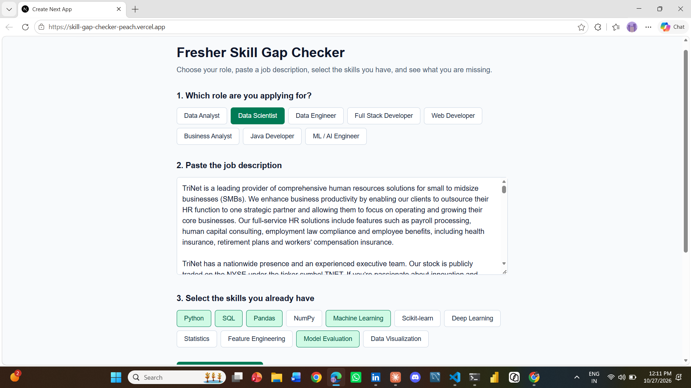

# Fresher Skill Gap Checker

A web app that helps freshers see how well their skills match a job description.

**Live app:** https://skill-gap-checker-peach.vercel.app

## What it does

1. Choose the role you are applying for.
2. Paste the job description.
3. Select the skills you already have (the skill list changes with the role).
4. Get your result:
   - If the job is **not** the role you chose, the app tells you which role it looks like.
   - If it is, you see a match percentage, the skills you have and the skills you are missing.

## Roles supported

Data Analyst, Data Scientist, Data Engineer, Full Stack Developer, Web Developer, Business Analyst, Java Developer, ML / AI Engineer

## How it works

- Each role has a list of skills and the words to look for in a job description.
- The app scores the pasted text against every role. A role title in the text counts for more than a single skill.
- If the chosen role is not close to the best-scoring role, the app reports the mismatch.
- Match % = skills you have / skills the job asks for.

## Built with

Next.js, React, TypeScript, Tailwind CSS, deployed on Vercel.

## Run it locally

    npm install
    npm run dev

Then open http://localhost:3000

## Limitations and next steps

- Matching is keyword-based, so unusual wording can be missed.
- Planned: a learning suggestion for each missing skill and saved skills in the browser.

## Author

Sai Krishna Thotte, https://www.linkedin.com/in/sai-krishna-80253831b
