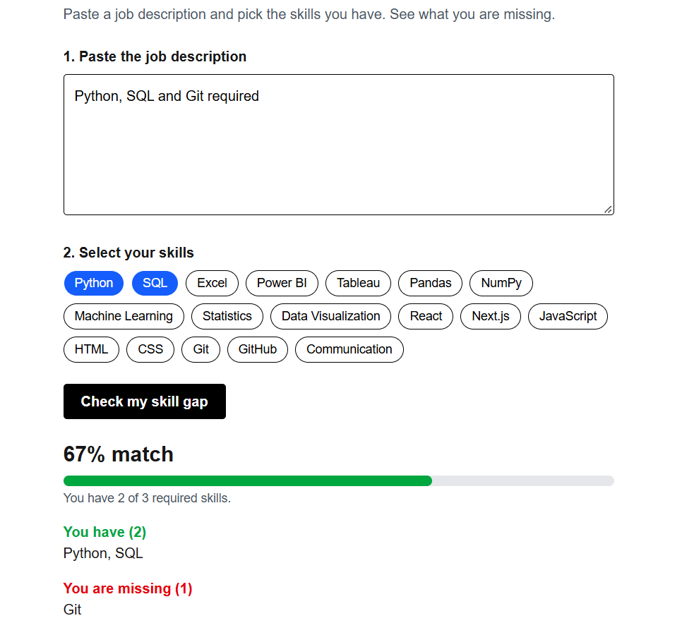

# Fresher Skill Gap Checker

A web app that helps freshers see which skills they are missing for a job.

**Live demo:** https://skill-gap-checker-peach.vercel.app



## How it works

1. Paste a job description.
2. Tick the skills you already have.
3. Click "Check my skill gap" to see your match percentage, the skills you have, and the skills you are missing.

## Built with

- Next.js and React
- Tailwind CSS
- TypeScript
- Deployed on Vercel

## What I learned

- React state and components
- Matching text against a skills list with JavaScript and regular expressions
- Pushing a project to GitHub and deploying it on Vercel

## Run it locally

```bash
git clone https://github.com/saiKrishna483/skill-gap-checker.git
cd skill-gap-checker
npm install
npm run dev
```

Then open http://localhost:3000.

## Future ideas

- A Gen AI version that suggests what to learn next
- Save selected skills in the browser
- A bigger skills list
